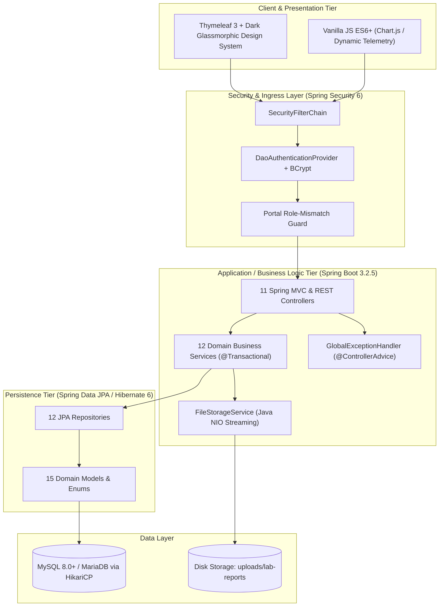
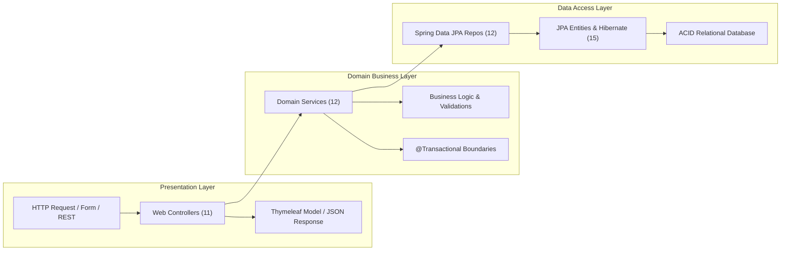
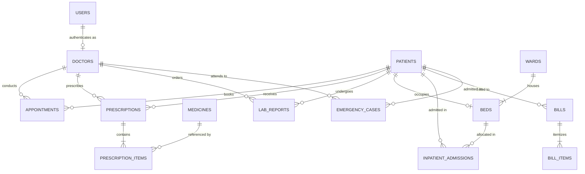
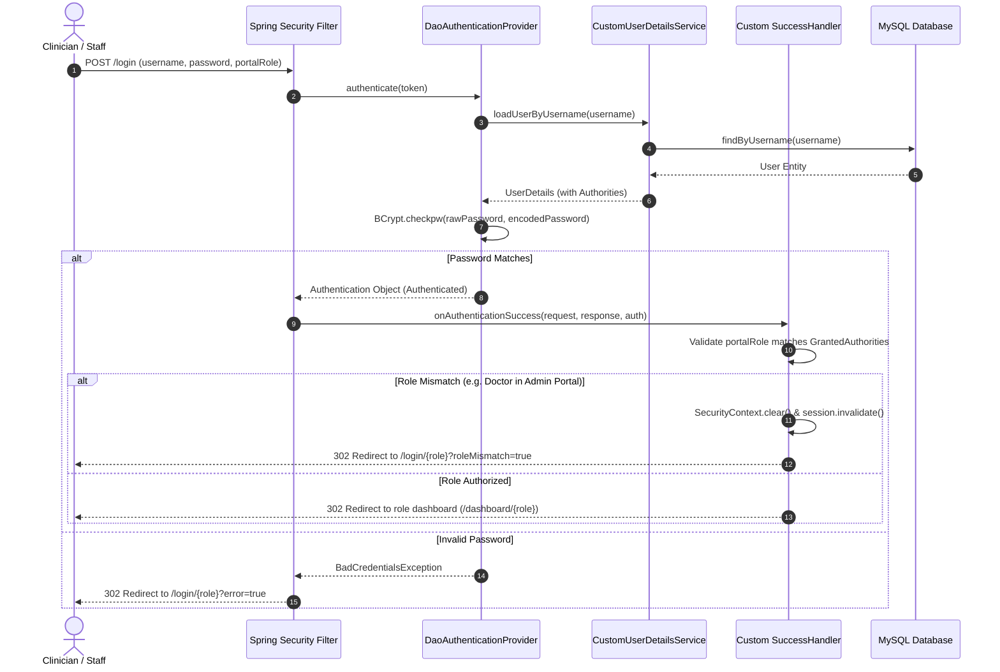
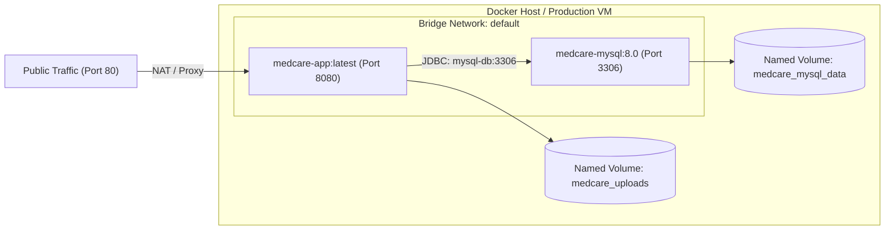
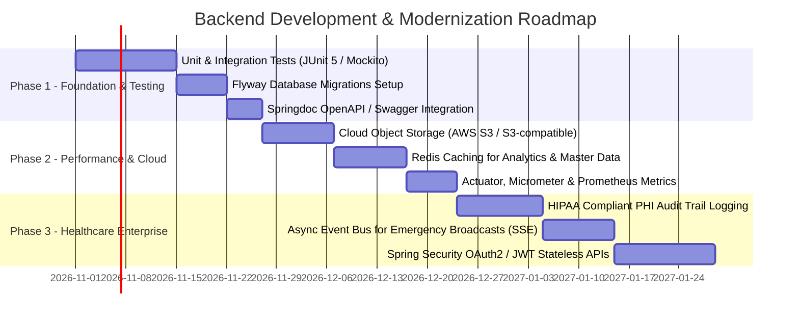

# MedCare - Hospital Management System (HMS)
## Senior Backend Developer Architectural & Technical Report

**Document Version:** 1.0.0  
**Target Platform:** Java 17+ (LTS) / Spring Boot 3.2.5 / Spring Security 6 / Hibernate 6  
**Primary Database:** MySQL 8.0+ / MariaDB 10.4+  
**Target Audience:** Engineering Leads, Senior Backend Developers, DevOps, and Solutions Architects  
**Repository Source:** `d:\Hospital Management System`  

---

## 1. Executive Summary & System Overview

The **MedCare Hospital Management System (HMS)** is an enterprise-grade, full-stack healthcare web application architected to digitize and automate end-to-end clinical operations, hospital administration, patient admissions, acute emergency triage, electronic prescribing, pharmaceutical stock reconciliation, laboratory diagnostics, and financial settlement.



### Key Technical Characteristics

| Dimension | Specification | Notes |
| :--- | :--- | :--- |
| **Language & Runtime** | Java 17 (OpenJDK 17 / Eclipse Temurin) | Fully compatible up to JDK 25 |
| **Framework Baseline** | Spring Boot 3.2.5 | Spring Framework 6.1.x, Spring Data 3.2.x |
| **Web Container** | Embedded Apache Tomcat 10.1.x | Configured on port `8080` (mapped to `80` in Docker) |
| **Security Framework** | Spring Security 6.2.x | BCrypt hashing, custom UserDetailsService, RBAC |
| **Persistence Engine** | Spring Data JPA / Hibernate 6.4.x | Relational mapping, transactional boundary control |
| **Connection Pooling** | HikariCP (Spring Boot Default) | High-performance JDBC connection management |
| **File Storage** | Java NIO Path Abstraction | Secure disk streaming with MIME auto-detection |
| **Deployment Mode** | Docker Alpine Container / Docker Compose | Containerized with health check probes |

---

## 2. Architecture & Design Patterns

The backend follows a **Layered Architecture (3-Tier Enterprise Web Application)**, enforcing strict separation of concerns between presentation, domain logic, and persistence.



### Software Design Patterns Implemented

1. **Model-View-Controller (MVC):**  
   Clean decoupling of HTTP handling and model preparation (`com.hospital.management.controller`), business rules (`com.hospital.management.service`), and data persistence (`com.hospital.management.repository`).
2. **Repository Pattern:**  
   Abstracts data access logic using Spring Data JPA interfaces (`JpaRepository`), eliminating boilerplate JDBC/SQL and providing declarative type-safe query generation.
3. **Domain Service Pattern:**  
   Core business operations (e.g., pharmacy dispensing, Manchester triage calculation, bed allocation, billing recalculation) are encapsulated in dedicated `@Service` classes rather than being polluted inside controllers or entities.
4. **Data Transfer Object (DTO) Pattern:**  
   Implemented in registration pipelines (`AdminRegisterDto`, `DoctorRegisterDto`, `ReceptionistRegisterDto`) to decouple HTTP payload ingestion from underlying JPA entity structures and prevent over-posting vulnerabilities.
5. **Role-Based Access Control (RBAC):**  
   Enforced at both the Spring Security filter chain layer and method execution level via `Role` enums (`ADMIN`, `DOCTOR`, `RECEPTIONIST`).
6. **Builder Pattern:**  
   Employed across domain entities (`Patient.builder()`, `BillItem.builder()`, `EmergencyCase.builder()`) for clean, immutable-style construction of complex entities with numerous clinical attributes.
7. **Strategy / Provider Pattern:**  
   Utilized by Spring Security's `DaoAuthenticationProvider` plugged with `BCryptPasswordEncoder` and `CustomUserDetailsService`.
8. **Global Exception Handling (AOP / Interceptor Pattern):**  
   Implemented via `@ControllerAdvice` in [GlobalExceptionHandler.java](file:///d:/Hospital%20Management%20System/src/main/java/com/hospital/management/config/GlobalExceptionHandler.java) to intercept unhandled runtime errors and resource 404s gracefully without leaking internal stack traces.

---

## 3. Package & Module Structure

The backend source tree is organized into cohesive, modular packages under `com.hospital.management`:

```
d:\Hospital Management System\src\main\java\com\hospital\management\
├── HospitalManagementApplication.java   # Spring Boot entry point (@SpringBootApplication)
├── config\                              # Infrastructure & security configurations
│   ├── DataInitializer.java            # Seed data pipeline for first-time boot
│   ├── GlobalExceptionHandler.java     # Centralized HTTP error interception
│   └── SecurityConfig.java             # Spring Security 6 filter chain & RBAC
├── controller\                          # HTTP MVC & REST Controller tier (11 files)
│   ├── AppointmentController.java
│   ├── AuthController.java
│   ├── BedController.java
│   ├── BillingController.java
│   ├── DashboardController.java
│   ├── DoctorController.java
│   ├── EmergencyController.java
│   ├── LabReportController.java
│   ├── PatientController.java
│   ├── PharmacyController.java
│   └── PrescriptionController.java
├── dto\                                 # Request Data Transfer Objects (3 files)
│   ├── AdminRegisterDto.java
│   ├── DoctorRegisterDto.java
│   └── ReceptionistRegisterDto.java
├── model\                               # JPA Domain Entities & Enums (15 files)
│   ├── Appointment.java
│   ├── Bed.java
│   ├── Bill.java
│   ├── BillItem.java
│   ├── Doctor.java
│   ├── EmergencyCase.java
│   ├── InpatientAdmission.java
│   ├── LabReport.java
│   ├── Medicine.java
│   ├── Patient.java
│   ├── Prescription.java
│   ├── PrescriptionItem.java
│   ├── Role.java                        # Enum: ADMIN, DOCTOR, RECEPTIONIST
│   ├── User.java
│   └── Ward.java
├── repository\                          # Spring Data JPA interfaces (12 files)
│   ├── AppointmentRepository.java
│   ├── BedRepository.java
│   ├── BillRepository.java
│   ├── DoctorRepository.java
│   ├── EmergencyCaseRepository.java
│   ├── InpatientAdmissionRepository.java
│   ├── LabReportRepository.java
│   ├── MedicineRepository.java
│   ├── PatientRepository.java
│   ├── PrescriptionRepository.java
│   ├── UserRepository.java
│   └── WardRepository.java
└── service\                             # Core business logic domain tier (12 files)
    ├── AppointmentService.java
    ├── BedService.java
    ├── BillingService.java
    ├── CustomUserDetailsService.java
    ├── DoctorService.java
    ├── EmergencyService.java
    ├── FileStorageService.java
    ├── LabReportService.java
    ├── PatientService.java
    ├── PharmacyService.java
    ├── PrescriptionService.java
    └── UserService.java
```

---

## 4. Database Schema & Relational Entity Model

The relational architecture comprises **14 tables** maintaining strict relational integrity, foreign key cascades, and temporal timestamps.



### Relational Entity Specifications

| Entity | Table Name | Primary Key | Key Foreign Keys & Relationships | Cardinality |
| :--- | :--- | :--- | :--- | :--- |
| **`User`** | `users` | `id` (Long, Auto) | None | `1:1` with `Doctor` (Optional) |
| **`Doctor`** | `doctors` | `id` (Long, Auto) | `user_id` -> `users.id` | `1:1` with `User`, `1:N` with `Appointment`, `Prescription`, `LabReport` |
| **`Patient`** | `patients` | `id` (Long, Auto) | Unique `patient_id` string | `1:N` with `Appointment`, `Prescription`, `Bill`, `LabReport`, `EmergencyCase` |
| **`Appointment`** | `appointments` | `id` (Long, Auto) | `patient_id` -> `patients.id`, `doctor_id` -> `doctors.id` | `N:1` with `Patient`, `N:1` with `Doctor` |
| **`Ward`** | `wards` | `id` (Long, Auto) | None | `1:N` with `Bed` |
| **`Bed`** | `beds` | `id` (Long, Auto) | `ward_id` -> `wards.id`, `patient_id` -> `patients.id` | `N:1` with `Ward`, `1:1` (optional) with `Patient` |
| **`InpatientAdmission`** | `inpatient_admissions` | `id` (Long, Auto) | `patient_id`, `bed_id` | Historical audit of ward stays and discharge summaries |
| **`Medicine`** | `medicines` | `id` (Long, Auto) | None | Master catalog with reorder thresholds & batch tracking |
| **`Prescription`** | `prescriptions` | `id` (Long, Auto) | `patient_id`, `doctor_id`, `appointment_id` | `1:N` cascade with `PrescriptionItem` |
| **`PrescriptionItem`**| `prescription_items` | `id` (Long, Auto) | `prescription_id`, `medicine_id` | `N:1` with `Prescription`, `N:1` with `Medicine` |
| **`LabReport`** | `lab_reports` | `id` (Long, Auto) | `patient_id`, `doctor_id` | Links to file attachment stored on disk |
| **`Bill`** | `bills` | `id` (Long, Auto) | `patient_id` -> `patients.id` | `1:N` cascade with `BillItem` |
| **`BillItem`** | `bill_items` | `id` (Long, Auto) | `bill_id` -> `bills.id` | Itemized charges breakdown |
| **`EmergencyCase`** | `emergency_cases` | `id` (Long, Auto) | `patient_id` (optional), `doctor_id` (optional), `bed_id` (optional) | 5-level Manchester triage, vitals telemetry |

---

## 5. Security & Authentication Architecture

The system utilizes **Spring Security 6** configured via [SecurityConfig.java](file:///d:/Hospital%20Management%20System/src/main/java/com/hospital/management/config/SecurityConfig.java).



### Core Security Highlights

1. **State-of-the-Art Cryptography:** Passwords are hashed using `BCryptPasswordEncoder` with salted cryptographic work factors. No plaintext credentials ever reach the persistent layer.
2. **Role Isolation & Anti-Crossover Defense:** A critical vulnerability in multi-role healthcare software is unauthorized role traversal (e.g., a receptionist attempting to access doctor clinical actions or admin configuration). The custom `AuthenticationSuccessHandler` dynamically verifies the calling `portalRole` against the user's granted Spring Security authorities (`ROLE_ADMIN`, `ROLE_DOCTOR`, `ROLE_RECEPTIONIST`). If a mismatch occurs, the session is invalidated immediately, and the user is redirected with an error notification.
3. **Session Hardening & Logout Sanitization:** Explicit logout handling clears authentication, invalidates the HTTP session, purges the `JSESSIONID` cookie, and redirects cleanly.
4. **Declarative Authorization Rules:**
   - Static assets (`/css/**`, `/js/**`, `/images/**`, `/fonts/**`): Public access.
   - Authentication routes (`/login/**`, `/register/**`): Public access.
   - Administrative paths (`/admin/**`, `/doctors/add`, `/beds/wards/add`): Restricted to `ROLE_ADMIN`.
   - Clinical prescribing (`/prescriptions/add`): Restricted to `ROLE_DOCTOR` and `ROLE_ADMIN`.
   - General application routes: Require authentication.
   - Unauthorized attempts: Routed to custom `/access-denied` view.

---

## 6. Core Business Workflows & Transactional Integrity

Backend transaction boundaries (`@Transactional`) ensure that complex multi-step clinical workflows maintain strict ACID compliance:

### Workflow A: E-Prescription Dispensing & Auto-Billing Pipeline

When a doctor writes a prescription and it is dispensed at the pharmacy counter via `PrescriptionService.dispensePrescription()`:

```mermaid
flowchart TD
    Start([POST /prescriptions/dispense/{id}]) --> Fetch[Fetch Prescription & Validate Status != 'Dispensed']
    Fetch --> LoopItems[Iterate Prescription Items]
    LoopItems --> StockCheck[Find Medicine in Master Inventory]
    StockCheck --> DeductStock[Decrement stockQuantity: max(0, current - qty)]
    DeductStock --> MarkItem[Mark item as Dispensed: true]
    MarkItem --> CreateBillItem[Build BillItem with unit price & line total]
    CreateBillItem --> CheckMore{More Items?}
    CheckMore -- Yes --> LoopItems
    CheckMore -- No --> CheckBill{Pending Bill for Patient Exists?}
    CheckBill -- Yes --> AppendBill[Append BillItems to Existing Bill]
    CheckBill -- No --> NewBill[Create New Bill with Status 'Pending']
    AppendBill --> Recalc[Recalculate Total Bill Amount]
    NewBill --> Recalc
    Recalc --> SaveBill[Persist Bill & BillItems]
    SaveBill --> UpdateRx[Set Prescription Status = 'Dispensed']
    UpdateRx --> CommitTx([Atomic DB Commit])
```

- **Transactional Guarantee:** If database write fails during bill creation or medicine deduction, the entire transaction rolls back; medicine stock is not deducted, and the prescription remains un-dispensed.

### Workflow B: Inpatient Admission & Discharge Lifecycle

Handled by [BedService.java](file:///d:/Hospital%20Management%20System/src/main/java/com/hospital/management/service/BedService.java):
1. **Admission:** Associates a bed with a patient, sets bed status to `Occupied`, and timestamps `admissionDate`.
2. **Discharge Calculation:** Calculates duration of stay using `ChronoUnit.DAYS` (with a 1-day minimum billing guarantee).
3. **Financial Settlement:** Computes `totalRoomCharge = daysStayed * bed.dailyRate`, writes an `InpatientAdmission` audit record, frees the bed (`status = 'Available'`, `patient = null`), and optionally creates/settles an invoice.

### Workflow C: 24/7 Emergency Trauma & Manchester Triage Engine

Handled by [EmergencyService.java](file:///d:/Hospital%20Management%20System/src/main/java/com/hospital/management/service/EmergencyService.java):
- Implements the 5-tier **Manchester Triage Protocol**:
  - `LEVEL_1_CODE_RED` (Immediate / Resuscitation, Priority 1, target 0 min)
  - `LEVEL_2_CODE_ORANGE` (Very Urgent, Priority 2, target 10 min)
  - `LEVEL_3_CODE_YELLOW` (Urgent, Priority 3, target 60 min)
  - `LEVEL_4_CODE_GREEN` (Standard, Priority 4, target 120 min)
  - `LEVEL_5_CODE_BLUE` (Non-Urgent, Priority 5, target 240 min)
- Supports anonymous intake for unconscious/unidentified trauma victims with temporary identifiers (`[UNIDENTIFIED-XXXX]`).
- Live vitals updating: Systolic/Diastolic BP, Heart Rate, SpO2, Respiratory Rate, Body Temperature, Glasgow Coma Scale (GCS 3–15), Blood Glucose, and Numeric Pain Scale.
- One-click ICU/ward bed escalation linking the trauma intake directly to `BedService`.

---

## 7. Diagnostic File Storage & Binary Streaming Subsystem

Managed by [FileStorageService.java](file:///d:/Hospital%20Management%20System/src/main/java/com/hospital/management/service/FileStorageService.java):

```mermaid
flowchart LR
    Upload[MultipartFile Upload] --> Sanitize[Sanitize Path & Replace Unsafe Chars]
    Sanitize --> Prefix[Prepend Timestamp & Category Prefix]
    Prefix --> WriteNIO[NIO Files.copy to uploads/lab-reports]
    WriteNIO --> MetaSave[Store metadata in LabReport Entity]

    MetaSave -.-> RequestStream[GET /lab/attachment/{id}]
    RequestStream --> LoadResource[UrlResource from Absolute Path]
    LoadResource --> DetectMIME[Auto-detect MIME Content-Type]
    DetectMIME --> InlineStream[HTTP 200 Inline Stream]

    MetaSave -.-> RequestDownload[GET /lab/download/{id}]
    RequestDownload --> LoadResourceDown[UrlResource from Absolute Path]
    LoadResourceDown --> SetHeader[Set Content-Disposition: attachment]
    SetHeader --> FileDownload[HTTP 200 Binary Download]
```

### Safety & Reliability Highlights

- **Path Traversal Protection:** Utilizes `StringUtils.cleanPath()` and regular expression replacement `[^a-zA-Z0-9\\.\\-_]` to prevent directory traversal (`../`) attacks.
- **Resource Streaming:** Streams files using Spring's `UrlResource`, ensuring low memory footprint when serving large high-resolution medical imaging scans (DICOM/X-Rays/MRIs).
- **Graceful Deletion:** Deletes files from disk when a lab report or attachment is removed, preventing orphaned files and disk bloat.

---

## 8. Backend API & Controller Route Catalog

The application exposes **50+ routes** across 11 controllers:

```
+-------------------------------------------------------------------------------------------------------------------+
| CONTROLLER            | METHOD | ENDPOINT                               | ACCESS ROLE         | TYPE / ACTION     |
+-------------------------------------------------------------------------------------------------------------------+
| DashboardController   | GET    | / or /dashboard                        | Authenticated       | Role Dispatcher   |
| DashboardController   | GET    | /dashboard/admin                       | ROLE_ADMIN          | Admin Dashboard   |
| DashboardController   | GET    | /dashboard/doctor                      | ROLE_DOCTOR, ADMIN  | Doctor Dashboard  |
| DashboardController   | GET    | /dashboard/receptionist                | RECEPTIONIST, ADMIN | Reception Board   |
| DashboardController   | GET    | /api/analytics/summary                 | Authenticated       | REST API (JSON)   |
| AuthController        | GET    | /login, /login/admin, /login/doctor... | Public              | Auth Portals      |
| AuthController        | POST   | /register/admin, /register/doctor...   | Public              | Self-Registration |
| PatientController     | GET    | /patients                              | Authenticated       | Search / Filter   |
| PatientController     | GET    | /patients/view/{id}                    | Authenticated       | 360 EHR Dossier   |
| PatientController     | POST   | /patients/save                         | Authenticated       | Persist / Update  |
| PatientController     | GET    | /patients/delete/{id}                  | ROLE_ADMIN          | Cascade Delete    |
| DoctorController      | GET    | /doctors                               | Authenticated       | Specialist Catalog|
| DoctorController      | POST   | /doctors/save                          | ROLE_ADMIN          | Onboard Physician |
| AppointmentController | GET    | /appointments                          | Authenticated       | Booking Queue     |
| AppointmentController | POST   | /appointments/save                     | Authenticated       | Slot Scheduling   |
| AppointmentController | GET    | /appointments/complete/{id}            | Authenticated       | Transition to Rx  |
| BedController         | GET    | /beds                                  | Authenticated       | Ward / Bed Matrix |
| BedController         | POST   | /beds/discharge/{id}                   | Authenticated       | Clinical Discharge|
| BedController         | GET    | /beds/discharge-summary/{id}           | Authenticated       | Printable Report  |
| PharmacyController    | GET    | /pharmacy                             | Authenticated       | Stock Catalog     |
| PharmacyController    | POST   | /pharmacy/restock/{id}                 | Authenticated       | Quick Stock Update|
| LabReportController   | GET    | /lab                                   | Authenticated       | Pathology Records |
| LabReportController   | GET    | /lab/attachment/{id}                   | Authenticated       | Inline Scan Stream|
| LabReportController   | GET    | /lab/download/{id}                     | Authenticated       | Binary File Stream|
| PrescriptionController| POST   | /prescriptions/save                    | ROLE_DOCTOR, ADMIN  | Rx Generation     |
| PrescriptionController| POST   | /prescriptions/dispense/{id}            | Authenticated       | Dispense & Bill   |
| BillingController     | GET    | /billing                               | Authenticated       | Financial Ledger  |
| BillingController     | POST   | /billing/pay/{id}                      | Authenticated       | Payment Settlement|
| EmergencyController   | GET    | /emergency                             | Authenticated       | Triage Dashboard  |
| EmergencyController   | POST   | /emergency/intake                      | Authenticated       | Manchester Intake |
| EmergencyController   | POST   | /emergency/case/{id}/update-vitals     | Authenticated       | Telemetry Polling |
| EmergencyController   | POST   | /emergency/case/{id}/admit             | Authenticated       | Ward/ICU Transfer |
+-------------------------------------------------------------------------------------------------------------------+
```

---

## 9. Containerization & Deployment Architecture

The backend includes a production-ready containerization topology:



### Docker Artifacts Analysis

1. **[Dockerfile](file:///d:/Hospital%20Management%20System/Dockerfile):**
   - Base Image: `eclipse-temurin:17-jre-alpine` (Minimal attack surface, lightweight ~150MB footprint).
   - Container health check: Configured with `wget --spider http://localhost:8080/login` testing responsiveness every 30s.
   - Tuned JVM Memory Parameters: `JAVA_OPTS="-Xms256m -Xmx768m"` providing predictable memory ceiling for cost-efficient cloud hosting (e.g. AWS t3.small / t4g.small).
2. **[docker-compose.yml](file:///d:/Hospital%20Management%20System/docker-compose.yml):**
   - Configures MySQL 8 container with automatic health check `mysqladmin ping`.
   - Uses `depends_on: mysql-db: condition: service_healthy` to prevent application boot race conditions before MySQL is fully accepting connections.
   - Mounts persistent Docker volumes for both MySQL database files and medical scan attachments (`medcare_uploads`).

---

## 10. Code Quality, Strengths & Technical Gap Analysis

### Key Engineering Strengths

1. **Clear Modular Boundaries:** Presentation, domain, and data access layers are well-delineated with zero logic leakage into JPA entities.
2. **Robust Multi-Role Security:** Custom portal mismatch validation solves an authentication trap common in multi-tenant/multi-role enterprise web applications.
3. **Resilient Data Seeding:** The [DataInitializer.java](file:///d:/Hospital%20Management%20System/src/main/java/com/hospital/management/config/DataInitializer.java) provides comprehensive mock data (doctors, patients, beds, inventories, diagnostic scans, bills, emergency vitals) ensuring zero-friction local and CI/CD onboarding.
4. **Strong Transaction Boundaries:** Complex mutations across repositories (e.g. prescription dispensing, bed discharge) are wrapped with `@Transactional` guarantees.

### Technical Gaps & Risk Assessment

| Risk Area | Severity | Impact | Recommended Remediation |
| :--- | :--- | :--- | :--- |
| **Missing Automated Test Suite** | **HIGH** | `src/test/java` is currently unpopulated; code changes risk functional regression in financial and clinical workflows. | Introduce JUnit 5, Mockito unit tests for Services, and `@WebMvcTest` / Testcontainers for integration tests. |
| **DDL Auto (`update`) in Production** | **MEDIUM** | Hibernate `ddl-auto: update` can introduce unexpected schema drift or lock tables in enterprise environments. | Integrate **Flyway** or **Liquibase** for version-controlled, auditable database migrations. |
| **Local Disk Storage for Uploads** | **MEDIUM** | Storing files in `uploads/lab-reports` on the local file system creates statefulness and prevents horizontal scaling across multiple container instances. | Introduce an abstract `StorageProvider` with implementations for **AWS S3** / **Azure Blob Storage**. |
| **N+1 Query Exposure** | **LOW-MEDIUM** | Default fetch behaviors on collections (e.g. `Prescription.items`, `Bill.items`) may trigger multiple sequential queries during large batch reads. | Introduce explicit `JOIN FETCH` JPQL queries or entity graphs for high-volume list screens. |
| **Lack of API Documentation** | **LOW-MEDIUM** | External integration partners (insurance systems, pathology machines) have no OpenAPI / Swagger contract. | Integrate `springdoc-openapi-starter-webmvc-ui` to auto-generate Swagger UI and OpenAPI 3.0 specs. |
| **PHI Audit Logging** | **LOW-MEDIUM** | Healthcare regulations (HIPAA / GDPR) mandate strict logging of who accessed or modified patient medical records. | Implement Spring Data JPA Auditing (`@CreatedBy`, `@LastModifiedDate`) and an append-only audit trail table. |

---

## 11. Strategic Engineering Roadmap & Recommendations



### Phase 1: Quality Assurance & Standards (Weeks 1–3)
- **Automated Testing Suite:** Establish comprehensive test coverage targeting:
  - `PrescriptionServiceTest`: Verify inventory deduction, bill linkage, and duplicate dispense guards.
  - `BedServiceTest`: Verify room duration calculations and discharge summaries.
  - `EmergencyServiceTest`: Verify Manchester triage priority assignments and vitals updating.
  - `SecurityIntegrationTest`: Verify portal role mismatch redirects and unauthorized URL rejections.
- **Flyway Migration:** Convert `Hospital_Management_Database_PUBLIC.sql` into baseline `V1__init_schema.sql` migration, replacing `ddl-auto: update`.
- **OpenAPI 3.0 Documentation:** Add Swagger UI at `/swagger-ui.html` for backend API documentation.

### Phase 2: Scalability & Cloud Readiness (Weeks 4–6)
- **Cloud Blob Storage:** Abstract `FileStorageService` behind a `StorageService` interface; add `S3FileStorageService` using AWS SDK v2 with pre-signed download URLs.
- **Distributed Caching (Spring Cache + Redis):** Cache read-heavy catalogs (`DoctorService.findAll()`, `MedicineService.findAll()`, `WardService.findAll()`) with TTL invalidation on mutation.
- **Application Observability:** Add `spring-boot-starter-actuator` with Prometheus metrics endpoint `/actuator/prometheus` to monitor JVM memory, garbage collection, and HikariCP connection pool saturation.

### Phase 3: Healthcare Enterprise & Integration (Weeks 7–10)
- **Audit Logging for PHI (Protected Health Information):** Implement an `@AuditLog` aspect intercepting accesses to `PatientController.viewPatient()` to record timestamp, accessor username, IP address, and patient ID in an immutable `audit_logs` table.
- **Server-Sent Events (SSE) for Real-Time ER Broadcasting:** Upgrade dashboard telemetry polling from periodic HTTP requests to Server-Sent Events (`SseEmitter`), pushing instant alerts when Code Red trauma victims arrive.
- **Stateless REST APIs & OAuth2/JWT Support:** Expand beyond session-based Thymeleaf to enable external mobile apps (iOS/Android clinician tablets) using Spring Authorization Server or JWT filters.

---

## 12. Conclusion & Developer Sign-Off

The MedCare Hospital Management System backend demonstrates **sound architectural craftsmanship**, leveraging modern Spring Boot 3.2 and Spring Security 6 conventions. The domain logic cleanly reflects complex real-world clinical demands—from emergency triage priority matrices and vital sign monitoring to atomic electronic prescribing and inventory stock reconciliation.

With the execution of the recommended **Phase 1 enhancements (automated testing suite and Flyway versioning)**, the backend is exceptionally well-positioned for enterprise production deployment in critical healthcare environments.

---
*Report compiled and certified by Senior Backend Engineering Agent (Antigravity).*
