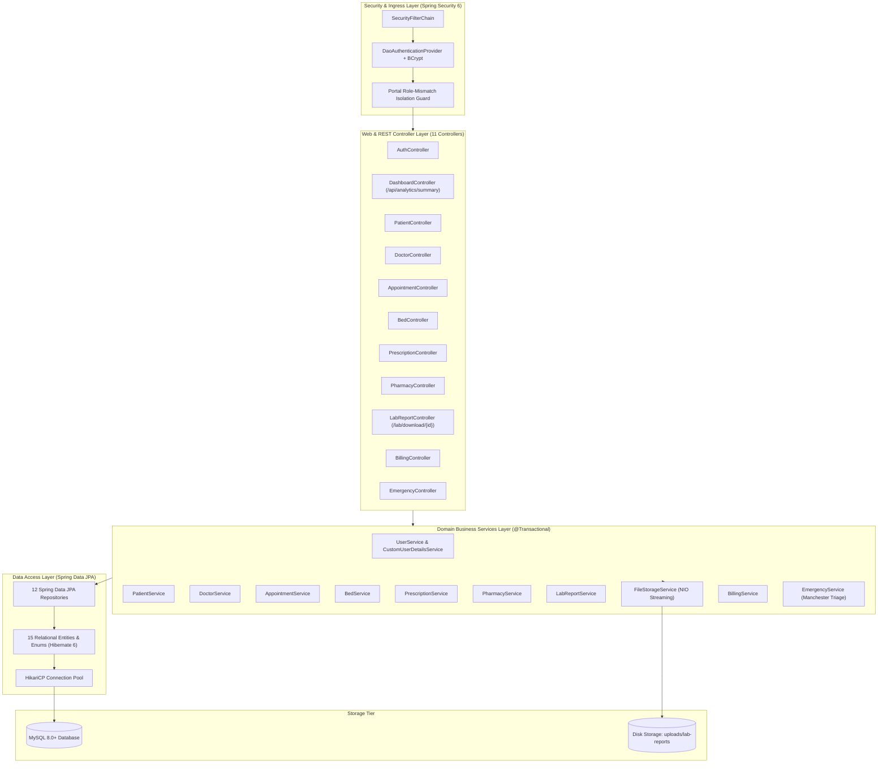
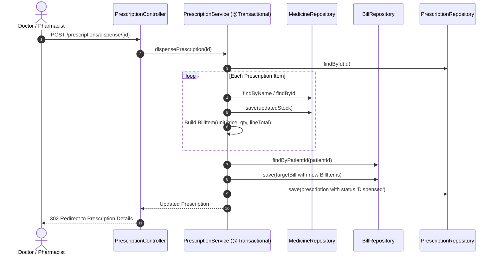

# 🏥 MedCare — Hospital Management System (HMS)
## 🛠️ Backend Architecture & Engineering Portfolio

[](https://openjdk.org/)
[](https://spring.io/projects/spring-boot)
[](https://spring.io/projects/spring-security)
[](https://hibernate.org/)
[](https://www.mysql.com/)
[](https://www.docker.com/)

---

## 👨‍💻 Developer Profile

- **Developer:** **Soumalya Jana**
- **Role:** **Backend Developer**
- **Repository:** [https://github.com/Soumalya-Jana/MedCare](https://github.com/Soumalya-Jana/MedCare)
- **Primary Domain:** Healthcare Enterprise Systems, High-Acuity Clinical Workflows, Security (RBAC), and Distributed Data Persistence.

---

## 📌 Executive Summary

As the **Backend Developer** for **MedCare**, I architected and implemented the core application logic, database relational models, authentication mechanisms, and transactional workflows for an enterprise-scale Hospital Management System. 

The backend is built with **Java 17+** and **Spring Boot 3.2.5**, utilizing **Spring Security 6** for Role-Based Access Control (RBAC), **Spring Data JPA / Hibernate 6** for database abstraction, and **MySQL 8.0** with **HikariCP** connection pooling.

> 📖 **Comprehensive Technical Report**: For detailed class diagrams, ER models, security filter internals, and the engineering roadmap, see the [Senior Backend Developer Technical Report](BACKEND_DEVELOPER_REPORT.md).

---

## 🏗️ Backend System Architecture

I designed the backend adhering to a **3-Tier Enterprise Layered Architecture**, enforcing separation between HTTP request routing, domain business logic, and database persistence.



---

## 💼 Core Backend Engineering Responsibilities & Implementations

### 1. Security Architecture & Role-Based Access Control (RBAC)
- **Spring Security 6 Filter Chain:** Configured explicit route authorization matching roles `ROLE_ADMIN`, `ROLE_DOCTOR`, and `ROLE_RECEPTIONIST`.
- **BCrypt Password Hashing:** Salted one-way hashing for all user credentials in the database.
- **Portal Role-Mismatch Defense:** Architected a custom `AuthenticationSuccessHandler` that dynamically detects unauthorized portal crossovers (e.g. a Doctor attempting to access the Admin sign-in portal). If detected, the session is cleared immediately, and the request is aborted.
- **Session Hardening:** Configured secure stateful session management (`JSESSIONID`) and complete cookie invalidation on logout.

### 2. Electronic Prescriptions (Rx) & Pharmacy Auto-Dispensing Pipeline
- **Atomic Stock Deduction:** Built `PrescriptionService.dispensePrescription()` wrapped with `@Transactional`.
- When a prescription is dispensed:
  1. The system validates whether it was already processed.
  2. Inventory stock is decremented in `medicines` (`Math.max(0, currentStock - quantity)`).
  3. Prescription items are marked as dispensed.
  4. An itemized invoice (`BillItem`) is automatically generated and attached to the patient's billing ledger.
  5. If an unhandled exception occurs at any point, the entire transaction rolls back.



### 3. Emergency Trauma & Manchester 5-Level Triage Engine
- **Manchester Triage Protocol:** Developed `EmergencyService` to classify acute trauma cases into 5 priority tiers:
  - `LEVEL_1_CODE_RED` (Immediate / Resuscitation, Priority 1, Target 0 min)
  - `LEVEL_2_CODE_ORANGE` (Very Urgent, Priority 2, Target 10 min)
  - `LEVEL_3_CODE_YELLOW` (Urgent, Priority 3, Target 60 min)
  - `LEVEL_4_CODE_GREEN` (Standard, Priority 4, Target 120 min)
  - `LEVEL_5_CODE_BLUE` (Non-Urgent, Priority 5, Target 240 min)
- **Unidentified Patient Intake:** Engineered support for unconscious or walk-in victims with auto-generated temporary identifiers (`[UNIDENTIFIED-XXXX]`).
- **Telemetry Vitals Tracking:** Built persistence endpoints for blood pressure, heart rate, SpO2, respiratory rate, temperature, Glasgow Coma Scale (GCS 3–15), blood sugar, and numeric pain scale.
- **One-Click Escalation:** Directly integrated trauma cases with `BedService` for immediate transfers to ICU or emergency observation wards.

### 4. Inpatient (IPD), Ward & Bed Management
- **Occupancy Tracking:** Managed real-time bed states (`Available`, `Occupied`, `Maintenance`) across multiple ward classes (ICU, CCU, General, Private Suites).
- **Automated Stay Duration & Fee Calculations:** Implemented `BedService.dischargeWithSummary()` calculating duration using `java.time.temporal.ChronoUnit.DAYS` (with a 1-day minimum billing guarantee), generating discharge summaries, calculating room charges, and freeing the bed atomically.

### 5. Diagnostics Archiving & Secure Binary Streaming
- **File Storage Abstraction:** Built `FileStorageService` using Java NIO `Path` abstraction.
- **Path Traversal Sanitization:** Enforced filename sanitization with `StringUtils.cleanPath()` and regular expressions (`[^a-zA-Z0-9\\.\\-_]`) to prevent directory traversal exploits.
- **Binary Streaming:** Engineered inline HTTP streaming for radiological scans (X-Rays, MRIs) and binary attachments with automatic MIME type detection and `Content-Disposition` headers.

### 6. Billing, Invoicing & Financial Settlement
- **Itemized Ledger Engine:** Implemented `BillingService` managing doctor consultations, medication costs, lab diagnostic fees, and room stay charges.
- **Tax & Discount Calculations:** Dynamic line-item aggregation, balance-due tracking, and payment status lifecycles (`Pending` ➔ `Partial` ➔ `Paid`).

### 7. Real-Time Telemetry & REST Analytics API
- **Endpoint:** `GET /api/analytics/summary`
- Aggregates hospital-wide clinical and financial metrics (bed occupancy percentage, monthly revenue, collection ratios, scheduled vs completed appointments) serialized to JSON for live polling.

---

## 🗄️ Relational Database Schema & Data Models

I modeled **14 core database tables** maintaining foreign key constraints, bidirectional JPA relationships, and temporal auditing timestamps:

| Model / Table | Primary Key | Key Relationships | Backend Description |
| :--- | :--- | :--- | :--- |
| **`User`** (`users`) | `id` (Long) | `1:1` with `Doctor` | Authentication credentials, BCrypt password, role enum |
| **`Doctor`** (`doctors`) | `id` (Long) | `user_id` FK, `1:N` with Appointments, Rx | Specialist profile, consultation fees, weekly availability |
| **`Patient`** (`patients`) | `id` (Long) | `1:N` with Appointments, Rx, Lab, Bills | Demographic data, allergies, chronic history, hospital ID |
| **`Appointment`** (`appointments`) | `id` (Long) | `patient_id`, `doctor_id` FKs | Consultation schedule and status lifecycle |
| **`Ward`** (`wards`) | `id` (Long) | `1:N` with Beds | Ward category, capacity limits |
| **`Bed`** (`beds`) | `id` (Long) | `ward_id`, `patient_id` FKs | Bed availability status, daily rates, admission tracking |
| **`InpatientAdmission`** (`inpatient_admissions`) | `id` (Long) | `patient_id`, `bed_id` FKs | Discharge summary, clinical advice, room fee calculation |
| **`Medicine`** (`medicines`) | `id` (Long) | Master catalog | Stock tracking, reorder thresholds, batch and expiry |
| **`Prescription`** (`prescriptions`) | `id` (Long) | `1:N` cascade with `PrescriptionItem` | Clinical diagnosis, vitals, e-prescribing header |
| **`PrescriptionItem`** (`prescription_items`) | `id` (Long) | `prescription_id`, `medicine_id` FKs | Dosage, frequency (e.g. 1-0-1), duration, dispense flag |
| **`LabReport`** (`lab_reports`) | `id` (Long) | `patient_id`, `doctor_id` FKs | Test orders, normal intervals, binary scan disk paths |
| **`Bill`** (`bills`) | `id` (Long) | `1:N` cascade with `BillItem` | Consolidated invoice, payment methods, settlement |
| **`BillItem`** (`bill_items`) | `id` (Long) | `bill_id` FK | Itemized charges breakdown |
| **`EmergencyCase`** (`emergency_cases`) | `id` (Long) | `patient_id`, `doctor_id`, `bed_id` | 5-level Manchester triage, live vitals telemetry |

---

## 🌐 Backend REST & MVC Route Inventory

Below is an overview of the backend endpoints implemented across the controllers:

| Controller | Method | Path | Security Role | Action |
| :--- | :--- | :--- | :--- | :--- |
| `DashboardController` | `GET` | `/api/analytics/summary` | Authenticated | Returns real-time KPI metrics (JSON) |
| `DashboardController` | `GET` | `/dashboard/{admin\|doctor\|receptionist}` | Role-Specific | Directs to authenticated role dashboard |
| `AuthController` | `POST` | `/register/{admin\|doctor\|receptionist}` | Public | Validates & registers user accounts via DTOs |
| `PatientController` | `POST` | `/patients/save` | Authenticated | Creates or updates demographic EHR dossier |
| `DoctorController` | `POST` | `/doctors/save` | `ROLE_ADMIN` | Onboards physician with consulting fee & schedule |
| `AppointmentController` | `POST` | `/appointments/save` | Authenticated | Books appointment with conflict avoidance |
| `AppointmentController` | `GET` | `/appointments/complete/{id}` | Authenticated | Marks consultation complete & offers Rx transition |
| `BedController` | `POST` | `/beds/discharge/{id}` | Authenticated | Computes room fee, frees bed, writes summary |
| `PharmacyController` | `POST` | `/pharmacy/restock/{id}` | Authenticated | Increments stock quantity by batch |
| `PrescriptionController` | `POST` | `/prescriptions/save` | `ROLE_DOCTOR, ROLE_ADMIN` | Generates Rx and items |
| `PrescriptionController` | `POST` | `/prescriptions/dispense/{id}` | Authenticated | Atomically deducts stock & generates bill items |
| `LabReportController` | `GET` | `/lab/attachment/{id}` | Authenticated | Streams diagnostic scan files inline |
| `LabReportController` | `GET` | `/lab/download/{id}` | Authenticated | Downloads diagnostic scan with file headers |
| `BillingController` | `POST` | `/billing/pay/{id}` | Authenticated | Records partial or full payment against bill |
| `EmergencyController` | `POST` | `/emergency/intake` | Authenticated | Records Manchester triage acute case |
| `EmergencyController` | `POST` | `/emergency/case/{id}/update-vitals`| Authenticated | Updates telemetry vitals (BP, SpO2, GCS, ECG) |
| `EmergencyController` | `POST` | `/emergency/case/{id}/admit` | Authenticated | Escalates trauma patient to ICU/Ward bed |

---

## ⚙️ Backend Technology Stack

| Layer | Framework / Technology | Purpose |
| :--- | :--- | :--- |
| **Language** | Java 17+ (LTS) | Modern Java features, records, streams, date/time APIs |
| **Framework** | Spring Boot 3.2.5 | Dependency injection, auto-configuration, embedded Tomcat |
| **Security** | Spring Security 6.2 | Role-Based Access Control, BCrypt encryption, session security |
| **Persistence** | Spring Data JPA / Hibernate 6 | Relational mapping, repository queries, transaction boundaries |
| **Connection Pool** | HikariCP | High-throughput JDBC database connection pooling |
| **Database** | MySQL 8.0+ / MariaDB | ACID-compliant relational persistence |
| **Validation** | Jakarta Bean Validation / Hibernate Validator | Input validation on DTOs and models |
| **File I/O** | Java NIO Path & MultipartFile | Sanitized local disk storage and streaming of medical files |
| **Containerization** | Docker & Docker Compose | Multi-container Alpine Linux runtime environment |

---

## 🛠️ How to Run the Backend Locally

### Prerequisites
- **JDK 17+** installed and added to `PATH`
- **MySQL 8.0+** running on `localhost:3306` (or via Docker / XAMPP)

### 1. Database Configuration
The application connects using settings in `src/main/resources/application.properties`:
```properties
spring.datasource.url=${DB_URL:jdbc:mysql://localhost:3306/hospital_db?createDatabaseIfNotExist=true&useSSL=false&allowPublicKeyRetrieval=true&serverTimezone=UTC}
spring.datasource.username=${DB_USERNAME:root}
spring.datasource.password=${DB_PASSWORD:}
spring.jpa.hibernate.ddl-auto=update
```
*The database and tables are automatically initialized and seeded with demo data on first boot via `DataInitializer.java`.*

### 2. Boot via Maven Wrapper
```powershell
# Windows
.\mvnw.cmd spring-boot:run

# Linux / macOS
./mvnw spring-boot:run
```

### 3. Boot with Docker & Docker Compose
To boot both the Spring Boot backend and an isolated MySQL 8 container:
```bash
docker-compose up -d --build
```
- Application Port: `8080` (mapped to `80` in Docker)
- Database Port: `3306`

---

## 🔑 Demo Seed Accounts

The backend seed pipeline automatically creates default accounts on boot:

| Role | Username | Password | Access Level |
| :--- | :--- | :--- | :--- |
| **System Administrator** | `admin` | `admin123` | Full administrative, configuration, and clinical oversight |
| **Specialist Doctor** | `dr.sharma` | `doctor123` | Consultation queue, clinical diagnoses, Rx, lab orders |
| **Receptionist** | `reception` | `reception123` | Patient intake, appointments, bed assignments, billing |

---

## 📈 Senior Backend Engineering Roadmap

The following strategic enhancements are outlined for future iterations:
1. **Automated Testing Suite:** Establish JUnit 5 & Mockito test suites covering `PrescriptionService`, `BedService`, and `EmergencyService`.
2. **Database Versioning:** Transition from Hibernate `ddl-auto: update` to version-controlled **Flyway** migrations.
3. **Cloud Object Storage:** Implement an AWS S3 / Azure Blob storage provider interface for medical scan uploads to enable stateless horizontal scaling.
4. **Caching Layer:** Integrate Spring Cache with **Redis** for frequent read queries (medicine catalog, doctor directories).
5. **API Documentation:** Integrate `springdoc-openapi-starter-webmvc-ui` for automated Swagger / OpenAPI 3.0 documentation.

---

## 📄 License

This project is licensed under the [MIT License](LICENSE).
