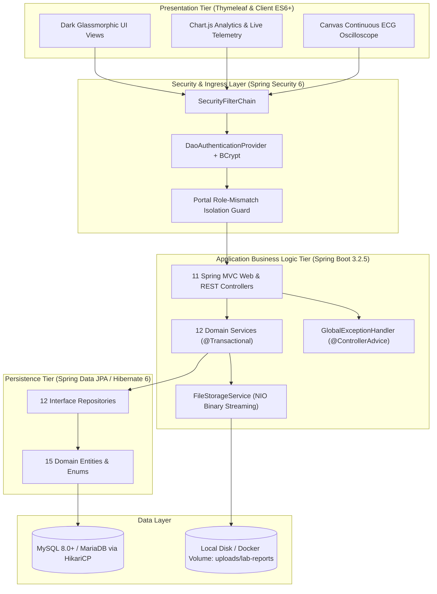

# 🏥 MedCare — Hospital Management System (HMS)

[](https://spring.io/projects/spring-boot)
[](https://openjdk.org/)
[](https://spring.io/projects/spring-security)
[](https://hibernate.org/)
[](https://www.mysql.com/)
[](https://www.docker.com/)
[](LICENSE)

An enterprise-grade, full-stack **Hospital Management System (HMS)** designed to digitize and automate healthcare workflows, clinical operations, inpatient care, emergency trauma triage, electronic prescriptions (Rx), pathology diagnostics, pharmacy inventory, and billing. Built using **Spring Boot 3.2**, **Spring Security 6**, **Spring Data JPA**, **Thymeleaf**, and **MySQL**, styled with a dark glassmorphic design system.

> 📖 **Deep Technical & Architectural Documentation**: For an in-depth engineering assessment, database ER models, transaction workflows, and security mechanisms, see the [Senior Backend Developer Technical Report](BACKEND_DEVELOPER_REPORT.md).

---

## 📌 Table of Contents

- [System Architecture](#-system-architecture)
- [Key Modules & Capabilities](#-key-modules--capabilities)
- [Default Demo Credentials & Portals](#-default-demo-credentials--portals)
- [Technology Stack](#-technology-stack)
- [Getting Started & Local Execution](#-getting-started--local-execution)
  - [Prerequisites](#prerequisites)
  - [Running with Maven Wrapper](#running-with-maven-wrapper)
  - [Running with 1-Click Batch Script](#running-with-1-click-batch-script)
  - [Running with Docker & Docker Compose](#running-with-docker--docker-compose)
- [REST API & Telemetry Endpoints](#-rest-api--telemetry-endpoints)
- [Project Directory Structure](#-project-directory-structure)
- [Contributing & License](#-contributing--license)

---

## 🏗️ System Architecture

The application is structured following a **3-Tier Enterprise Web Architecture (MVC)**, enforcing separation between presentation, domain business rules, and persistence:



---

## 🚀 Key Modules & Capabilities

1. **Executive & Role-Based Dashboards**: Real-time hospital operational KPIs, live Chart.js interactive visualizations (6-month revenue trends, inpatient bed occupancy doughnut, appointment pipeline), and REST API (`/api/analytics/summary`) for live polling.
2. **Emergency, Trauma & Manchester Triage (24/7 Command Center)**:
   - Acute trauma intake supporting registered patients or unidentified walk-in/unconscious victims.
   - 5-level Manchester Triage protocol (`Code Red`, `Code Orange`, `Code Yellow`, `Code Green`, `Code Blue`).
   - Real-time vital signs telemetry: BP, Heart Rate, SpO2, Respiratory Rate, Temp, Glasgow Coma Scale (GCS 3–15), Blood Sugar, and Pain Score.
   - Live animated continuous Lead II ECG rhythm monitor.
   - 1-click direct ICU/ward bed transfer and executive dashboard emergency broadcast ribbons.
3. **Patient Management & Electronic Health Records (EHR)**: Full patient registration, auto-generated hospital IDs, blood group tracking, allergies with visual badges, chronic conditions, and a 360-degree patient clinical dossier.
4. **Doctor Management & Clinical Directory**: Specialist physician profiles, departmental classification, consulting fee configuration, weekly consulting schedules, and direct user account linking.
5. **Outpatient (OPD) Appointment Scheduling**: Real-time doctor-patient consultation booking, conflict avoidance, lifecycle management (`Scheduled` ➔ `Completed` / `Cancelled`), and seamless 1-click transition to prescription drafting.
6. **Inpatient (IPD), Ward & Bed Management**: Ward capacity configuration across multiple categories (General, ICU, CCU, Private Suite), real-time bed status indicators (`Available`, `Occupied`, `Maintenance`), admission logging, duration-based room charge calculations, and printable Inpatient Discharge Summaries.
7. **Pharmacy & Medicine Inventory**: Pharmaceutical master catalog (brand, generic, batch, manufacturer), automated low-stock and out-of-stock alert banners, unit pricing, expiration tracking, and a 1-click Quick Restock Modal with preset increments (`+10`, `+50`, `+100`).
8. **Digital Prescriptions (Rx) & E-Prescribing**: Structured clinical Rx generation with chief complaints, clinical vitals, multi-item medication schedules (dosage, frequency e.g. `1-0-1`, duration), print-ready Rx slips, and automated 1-click pharmacy dispensing that atomically deducts medicine inventory stock and generates itemized billing.
9. **Laboratory, Diagnostics & Medical Imaging**: Diagnostic order catalog (Blood, Urine, Biochemistry, X-Ray, CT, MRI, Ultrasound, ECG, Pathology), normal reference intervals, secure binary scan file attachments (Chest X-Rays, Brain MRIs, Pathology PDFs) with darkroom radiography viewer and inline file streaming.
10. **Billing, Invoicing & Financial Settlement**: Automated multi-service invoice generation (consultation fees, dispensed pharmacy drugs, lab diagnostics, and room stay charges), itemized line items (`BillItem`), tax and discount calculations, and payment tracking (`Pending`, `Partial`, `Paid`).
11. **Security & Role-Based Access Control**: Spring Security 6 with salted BCrypt password hashing, stateful HTTP session management, and portal role-mismatch defense.

---

## 🔑 Default Demo Credentials & Portals

The application automatically seeds demonstration accounts on first boot via `DataInitializer.java`:

| Role | Username | Password | Dedicated Login Portal | Dedicated Registration Portal | Access Permissions |
| :--- | :--- | :--- | :--- | :--- | :--- |
| **System Administrator** | `admin` | `admin123` | `/login/admin` | `/register/admin` | Full hospital administration & all clinical modules |
| **Consulting Doctor** | `dr.sharma` | `doctor123` | `/login/doctor` | `/register/doctor` | Appointments, patient EHR, clinical Rx, lab diagnostic orders |
| **Front Desk / Receptionist** | `reception` | `reception123` | `/login/receptionist` | `/register/receptionist` | Patient intake, OPD bookings, bed allocations, billing |

> 💡 **Unified Authentication Hub**: Access `/login` or `/register` for an interactive glassmorphic role selector card interface.

---

## ⚙️ Technology Stack

| Component | Technology | Description |
| :--- | :--- | :--- |
| **Backend Framework** | Spring Boot 3.2.5 | Core dependency injection and microservice architecture |
| **Programming Language** | Java 17+ (LTS) | Compatible with JDK 17, 21, and 25 |
| **Security Framework** | Spring Security 6.2 | Role-based authorization, BCrypt hashing, and session management |
| **ORM / Persistence** | Spring Data JPA / Hibernate 6 | Declarative repositories and relational mapping |
| **Database** | MySQL 8.0+ / MariaDB 10.4+ | Relational schema with HikariCP connection pooling |
| **View Engine** | Thymeleaf 3 | Server-side templating with Spring Security dialect |
| **Styling & UI** | Vanilla CSS3 | Custom dark glassmorphic design system with CSS custom properties |
| **Data Visualizations** | Chart.js 4.x | Interactive doughnut, bar, and curved area analytics |
| **Iconography & Fonts** | Boxicons 2.1 / Inter | Vector iconography and modern typography |
| **Containerization** | Docker & Docker Compose | Multi-container runtime with health checks |

---

## 🛠️ Getting Started & Local Execution

### Prerequisites

- **Java Development Kit (JDK)**: JDK 17 or higher installed (e.g., Eclipse Temurin or Oracle JDK).
- **Database**: MySQL 8.0+ or MariaDB (via XAMPP, MySQL Workbench, or Docker).
- **Build Tool**: Apache Maven 3.9+ (or use the bundled `mvnw` wrapper).

---

### Running with Maven Wrapper

1. **Clone the repository:**
   ```bash
   git clone https://github.com/ujjwalsharma52/Hospital-Management-System.git
   cd Hospital-Management-System
   ```

2. **Ensure MySQL is running:**
   - Default expected database URL: `jdbc:mysql://localhost:3306/hospital_db`
   - Default credentials: user `root`, no password.
   - Spring Boot will automatically create and seed the database on initial launch.

3. **Start the application:**
   - **Windows:**
     ```powershell
     .\mvnw.cmd spring-boot:run
     ```
   - **Linux / macOS:**
     ```bash
     chmod +x mvnw
     ./mvnw spring-boot:run
     ```

4. **Access the application:**
   Open your browser and navigate to:
   ```
   http://localhost:8080
   ```

---

### Running with 1-Click Batch Script (Windows)

Simply double-click the included automation script:
```bat
run.bat
```
This script will locate your installed JDK (including `D:\JDK 25` if present) and boot the application cleanly.

---

### Running with Docker & Docker Compose

Deploy the application and an isolated MySQL 8 instance with a single command:

```bash
docker-compose up -d --build
```

- Web Application: `http://localhost` (Port 80)
- MySQL Database: `localhost:3306`
- Persistent volumes: `medcare_mysql_data` (database) and `medcare_uploads` (diagnostic scans).

To view application logs:
```bash
docker-compose logs -f medcare-app
```

To stop the containers:
```bash
docker-compose down
```

---

## 🌐 REST API & Telemetry Endpoints

In addition to Thymeleaf web controllers, the backend provides endpoints for live analytics and binary file streaming:

| Endpoint | Method | Role | Description |
| :--- | :--- | :--- | :--- |
| `/api/analytics/summary` | `GET` | Authenticated | Live JSON payload containing total patients, revenue, bed occupancy, and appointment pipeline counts. |
| `/lab/attachment/{id}` | `GET` | Authenticated | Streams raw medical scans (X-Rays, MRIs) inline with automatic MIME detection. |
| `/lab/download/{id}` | `GET` | Authenticated | Downloads diagnostic scan attachments with proper `Content-Disposition` headers. |

---

## 📁 Project Directory Structure

```
Hospital-Management-System/
├── src/
│   ├── main/
│   │   ├── java/com/hospital/management/
│   │   │   ├── config/          # Security, DataInitializer, Global Exception Handler
│   │   │   ├── controller/      # 11 Spring MVC Web & REST Controllers
│   │   │   ├── dto/             # Registration Data Transfer Objects
│   │   │   ├── model/           # 15 JPA Domain Entities and Role Enum
│   │   │   ├── repository/      # 12 Spring Data JPA Repositories
│   │   │   └── service/         # 12 Domain Business Services
│   │   └── resources/
│   │       ├── static/          # CSS, JS, Boxicons, images
│   │       ├── templates/       # 38 Thymeleaf HTML templates (Dark Glassmorphic UI)
│   │       └── application.properties # Spring configuration & environment overrides
├── uploads/                     # Storage for radiological scans and pathology PDFs
├── BACKEND_DEVELOPER_REPORT.md  # Comprehensive Senior Backend Developer Report
├── Dockerfile                   # Eclipse Temurin 17 JRE Alpine container spec
├── docker-compose.yml           # Multi-service composition (App + MySQL 8)
├── AWS_DEPLOYMENT_GUIDE.md      # Cloud deployment guide for AWS EC2 / ECS
├── Hospital_Management_Database_PUBLIC.sql # Standalone SQL database dump
├── pom.xml                      # Maven dependencies & build configurations
└── run.bat                      # Windows 1-click startup automation
```

---

## 📄 License

This project is licensed under the [MIT License](LICENSE).
